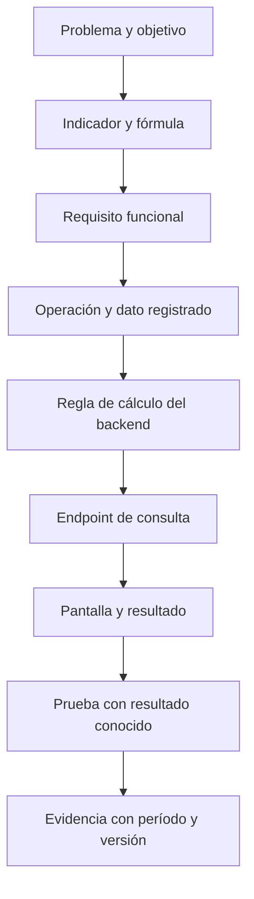

# Indicadores, fórmulas y trazabilidad de StockGuard

Esta guía conecta el informe académico con el funcionamiento implementado. Explica qué se mide,
de dónde salen los datos, dónde se calculan los resultados y qué evidencia debe llevar el informe.
Se contrastó con el avance compartido, el caso 05 y el código de la rama front.

## 1. ¿El proyecto está relacionado con sus indicadores?

Sí. La relación prevista en el avance es:

| Grupo | Variable del informe | Qué permite comprobar | Fuente principal |
|---|---|---|---|
| I01–I04 | Nivel de implementación y validación de StockGuard | Requisitos aceptados, autorización, integración y reglas verificadas. | Resultados de pruebas y aceptación asociados a una versión. |
| I05–I10 | Desempeño del control de inventario y reposición | Quiebres, urgencias, coincidencia física, tiempo de aprobación, duplicidad y sobrestock. | Operaciones registradas en PostgreSQL y fotografías de stock. |

Los indicadores operativos ya los calcula el backend y Angular los presenta en Indicadores.
Los técnicos se generan con el verificador y se consultan en Evidencias; ese reporte declara alcance backend.
La aceptación integrada debe contrastarse también con las pruebas reales de navegador y el entorno entregado.

**Tener un módulo y calcular correctamente su indicador no demuestra, por sí solo, que el negocio mejoró.**
Eso requiere una comparación documentada bajo condiciones equivalentes.

## 2. ¿Se necesita otra herramienta para medir?

En los archivos revisados no se encontró una exigencia de calcular I05–I10 en una herramienta
externa. La sección 1.8 del avance sitúa su cálculo en los registros operativos del sistema y su
presentación en indicadores/dashboard. Una indicación adicional del docente podría complementar esto.

Si se utiliza otra herramienta, debe quedar claro su propósito:

| Propósito | Qué ocurre | Relación con StockGuard |
|---|---|---|
| Registro y cálculo operativo | Guardar movimientos, solicitudes, fechas, conteos y calcular I05–I10. | Lo realizan PostgreSQL y el backend; Angular presenta el resultado. |
| Verificación | Comprobar respuestas, permisos, transacciones y cálculos conocidos. | Se usan pruebas automatizadas; un cliente de API puede servir para repetir consultas. |
| Análisis de resultados | Organizar semanas, comparar antes/después y preparar tablas o gráficos. | Puede hacerse después en una hoja de cálculo u otra herramienta de análisis, conservando el origen de cada dato. |
| Rendimiento | Medir latencia, errores y concurrencia. | Corresponde a pruebas de rendimiento; no sustituye los seis indicadores operativos. |

No hay actualmente una integración automática de exportación a Excel, SPSS o Power BI.
Si se trabaja allí, registrar cómo se obtuvieron los datos: respuesta de API guardada, ficha de
medición o consulta reproducible. No afirmar que existe un botón de exportación que no se implementó.

## 3. Qué significa trazabilidad

Es poder seguir una cadena completa y defender cada vínculo:

Una captura del porcentaje muestra el resultado, pero la trazabilidad completa permite explicar
qué registros lo produjeron, qué filtros se aplicaron y cómo se comprobó la fórmula.

## 4. Fórmulas de I01–I04

| Código | Fórmula | Criterio que debe acompañarla |
|---|---|---|
| I01 | Requisitos críticos aceptados / 10 requisitos RF01–RF10 × 100 | Definir aceptación por requisito y adjuntar pruebas. La cobertura backend no representa automáticamente toda la interfaz y el despliegue. |
| I02 | Contratos que superan sus casos de autorización / contratos protegidos definidos × 100 | Un contrato es método + ruta. Verificar acceso permitido y rechazos por token/rol. El total se toma de la matriz de esa versión. |
| I03 | Flujos críticos aceptados / 5 flujos F01–F05 × 100 | Identificar qué pasos y resultados de persistencia se probaron desde Angular. Separar el resultado HTTP/backend del recorrido real de navegador. |
| I04 | Reglas críticas con pruebas aprobadas / 8 reglas RN01–RN08 × 100 | Vincular pruebas positivas y negativas a cada regla; una regla con un caso requerido fallido no se declara aprobada. |

No calcular I01 como pruebas aprobadas / pruebas totales. Tener 102 pruebas Angular aprobadas
no cambia el denominador de 10 requisitos, 5 flujos u 8 reglas. Tampoco convertir los veinte grupos
de escenarios del runner de navegador en veinte flujos críticos distintos.

El script [Verificar-APF3.ps1](backend/docs/APF3/Verificar-APF3.ps1) calcula porcentajes sobre
sus grupos de requisitos, contratos, flujos y reglas. El campo alcance debe acompañar los resultados.
[EvidenciaController](backend/src/main/java/com/byteelement/stockguard/controller/EvidenciaController.java)
lee el reporte guardado: abrir Evidencias no ejecuta pruebas nuevas.

## 5. Fórmulas y criterios de I05–I10

### I05. Quiebre semanal

**Productos críticos distintos que tuvieron saldo cero en algún almacén observado durante la semana
/ productos críticos distintos de la población evaluada × 100.**

La implementación fija la población con el último corte dentro del período y reconstruye saldos
al inicio más movimientos del período. Un producto se cuenta una vez, aunque tenga quiebre en
varios almacenes. Recuperar stock después no elimina el quiebre que ya ocurrió.
Para que sea semanal, seleccionar los límites de esa semana; la API admite otros períodos.

Preparar el saldo inicial antes de comenzar la semana evaluada. Un producto nuevo sin historial
previo se reconstruye inicialmente con cero; eso debe contemplarse al diseñar el escenario.

### I06. Compras urgentes

**Órdenes emitidas como urgentes en el período / total de órdenes emitidas en el período × 100.**

La fecha de inclusión es emitidaEn. La clasificación proviene de la solicitud con su motivo y pasa
a la orden. Las órdenes canceladas después siguen formando parte de lo que se emitió.
Las solicitudes todavía sin orden no se cuentan como órdenes emitidas.

### I07. Coincidencia de inventario

**Observaciones de conteo con cantidad física igual al saldo registrado al contar
/ total de observaciones de conteo del período × 100.**

La unidad es una observación producto/almacén/fecha. Contar el mismo par en otro momento genera
otra observación. El sistema compara cantidadFisica con saldoCorte y filtra por fechaCorte.
Incluye los conteos registrados, no solamente los que ya tienen ajuste confirmado.
Un ajuste posterior no convierte una discrepancia original en coincidencia.

Actualizar el texto ambiguo de “pares contados” del informe para que coincida con esta unidad.
La implementación usa la entidad Conteo y tabla conteo; no existe una tabla ConteoDetalle.

### I08. Tiempo promedio de aprobación

**Suma de duraciones entre aprobadaEn y enviadaEn, en segundos
/ número de solicitudes aprobadas incluidas / 86400.**

La unidad final es días calendario. La fecha de inclusión en el período es aprobadaEn: una
solicitud enviada antes puede entrar si fue aprobada dentro del período. No se incluyen rechazos.
El servidor registra las marcas de tiempo. El valor se redondea a cuatro decimales de día.
El numerador informado muestra segundos enteros; internamente se consideran fracciones de segundo.
Para una comprobación de máxima precisión, contrastar también los timestamps originales.

### I09. Solicitudes duplicadas

**Solicitudes enviadas en el período con duplicidad confirmada
/ total de solicitudes enviadas en el período × 100.**

La fecha de inclusión es enviadaEn. Una advertencia de similitud no basta: Supervisor debe
confirmar la duplicidad y queda guardada la fecha de confirmación y relación con la original.
Reintentar la misma solicitud no crea otra fila y no aumenta este porcentaje.
La consulta es retrospectiva: confirmar después una duplicidad puede modificar el resultado de
un período anterior. Registrar la fecha de extracción y conservar la respuesta usada en el informe.

### I10. Productos sobre el máximo

**Productos críticos distintos cuyo saldo supera el máximo en algún almacén del corte evaluado
/ productos críticos distintos evaluados en ese corte × 100.**

Se usa el último corte dentro del período, con cantidades y máximos conservados en esa fotografía.
Igualar el máximo no cuenta como exceso. El producto se cuenta una sola vez, no una vez por almacén.
Los pares críticos seleccionados deben tener una política; una política faltante se informa como
error y no se interpreta como máximo cero ni como una medición completa.

### Criterios comunes

- Registrar período, SKU y almacén elegidos. Los límites de API son desde inclusivo y hasta exclusivo;
  Angular convierte las fechas de Lima e incluye completo el día indicado en Hasta.
- I05 e I10 necesitan un corte dentro del período. Generar el corte al cierre previsto de la medición
  y conservar el lote, porque no representan simplemente el stock vivo que se consulta después.
- Denominador cero significa valor null y sinDatos=true. No convertirlo en 0%.
- Los porcentajes se redondean a dos decimales. No promediar sin ponderar porcentajes de grupos
  con denominadores distintos; si se consolida una tasa compatible, conservar sus conteos de origen.

El cálculo está en [ReporteService](backend/src/main/java/com/byteelement/stockguard/service/ReporteService.java).
El contrato [IndicadorResponse](backend/src/main/java/com/byteelement/stockguard/dto/IndicadorResponse.java)
incluye código, nombre, unidad, numerador, denominador, valor, sinDatos, desde, hasta y lote cuando corresponde.

## 6. Matriz resumida indicador → software

Los RF de la tabla son los vínculos principales; RF08 presenta los seis resultados y RF09 protege
sus operaciones. Los movimientos de RF02 aportan además el historial necesario para I05.

| Indicador / problema | RF relacionados | Dato que lo alimenta | Pantalla y rol | Comprobación / evidencia |
|---|---|---|---|---|
| I05 · Quiebres | RF01, RF03, RF08 | Criticidad y cantidades de corte; saldo inicial y movimientos. | Almacén registra movimientos; Supervisor genera corte; Supervisor/Administrador consultan. | Producto que llega a cero y luego se repone sigue contado; no duplicarlo entre almacenes. Guardar cálculo y lote. |
| I06 · Urgencias | RF03, RF05, RF08 | orden_compra.urgente y emitida_en; motivo heredado de la solicitud. | Compras solicita/emite; Supervisor aprueba; Indicadores muestra el porcentaje. | Una orden urgente de dos emitidas produce 50%. Conservar IDs, período y respuesta. |
| I07 · Diferencias físicas | RF02, RF07, RF08 | conteo.cantidad_fisica, saldo_corte y fecha_corte. | Almacén registra conteo; Supervisor confirma ajuste y consulta indicador. | Un conteo coincidente de dos produce 50%; ajustar el otro no reescribe la observación original. |
| I08 · Demora al aprobar | RF05, RF08 | solicitud_compra.enviada_en, aprobada_en y estado. | Compras envía; Supervisor aprueba; Indicadores muestra promedio en días. | Duraciones de un día y tres días producen promedio de dos días; comprobar fechas y denominador. |
| I09 · Solicitudes repetidas | RF04, RF08 | enviada_en, duplicada_de_id y duplicidad_confirmada_en. | Compras ve similitudes; Supervisor confirma duplicidad; Indicadores muestra tasa. | Una adicional confirmada de dos solicitudes produce 50%; una advertencia sola no aumenta el numerador. |
| I10 · Exceso | RF01, RF03, RF08 | corte_stock.cantidad, maximo, criticidad y lote. | Supervisor configura límites/genera corte; Supervisor/Administrador consultan. | Saldo superior al máximo cuenta; igual al máximo no. Cambiar la política después no modifica el corte guardado. |

Todos se consultan mediante **GET /api/v1/indicadores?codigo=I08**, cambiando codigo por I05–I10
y añadiendo desde, hasta y los filtros opcionales sku/almacenId. GET /api/v1/dashboard agrupa los seis. Angular actualmente consulta
los indicadores individuales para poder presentar errores parciales.

Las fechas de inclusión cambian según el indicador. Consultar una misma semana en todos ellos
no implica que se cuenten exactamente las mismas solicitudes, órdenes o conteos.

## 7. Ejemplo completo para explicarlo: I08

1. Problema: las solicitudes tardan en aprobarse.
2. Objetivo: evaluar y reducir esa demora.
3. RF05: permitir envío por Compras y decisión por Supervisor con marcas de tiempo del servidor.
4. Datos: ID, enviadaEn, aprobadaEn, estado y actor de cada solicitud aprobada incluida.
5. Regla: sumar las duraciones, dividir entre aprobaciones y convertir a días.
6. Endpoint: consultar I08 para el período acordado.
7. Pantalla: Indicadores → Tiempo de aprobación → Ver cálculo.
8. Prueba controlada: una solicitud tarda un día y otra tres días.
9. Evidencia: sumar 345600 segundos / 2 / 86400 = **2 días**, y guardar las fechas que permiten comprobarlo.

Ese caso está cubierto en RF08_I06_I08_I09FiltranPeriodoYDenominador de
[Apf3ComprasIntegrationTest](backend/src/test/java/com/byteelement/stockguard/integration/Apf3ComprasIntegrationTest.java).
Las fechas conocidas se preparan solo en la base aislada de pruebas. No se alteran tiempos de
operación para aparentar un mejor resultado.

## 8. Dónde colocarlo en el informe

El avance compartido ya tiene estas secciones. Se deben actualizar con lo implementado:

| Sección | Contenido que corresponde |
|---|---|
| 1.6 · Consistencia | Problema, objetivo, variables y vínculo con cada indicador. Mantener I01–I04 como intervención e I05–I10 como resultado. |
| 1.7 · Operacionalización | Fórmula, unidad, unidad de observación, campos fuente, periodicidad, fecha de inclusión, filtros y tratamiento sin datos. |
| 1.8 · Trazabilidad | RF → dato → regla → endpoint → componente real → prueba → evidencia identificada. |
| Capítulo II · Diseño | Campos y tablas realmente implementados, estados de compra, roles, transacciones y diagramas actualizados. |
| Capítulo III · Desarrollo y validación | Recorridos con roles, pruebas de cálculo y rechazos, datos de origen, capturas, versión y resultados observados. |
| Evaluación / resultados, según plantilla | Protocolo y comparación antes/después; herramienta de análisis si se usa; limitaciones y discusión. |
| Anexos | Ficha por indicador, respuestas guardadas, detalle de registros, resultados de pruebas y parámetros del escenario. |

Reemplazar nombres propuestos de componentes por los reales: AdminQueries presenta Indicadores;
AdminSystem presenta Evidencias. No dejar nombres de diseño como si fueran clases implementadas.
Actualizar ConteoDetalle por Conteo, las migraciones/tablas y las rutas reales. Consultar también
[CAMBIOS-INFORME.md](backend/docs/APF3/CAMBIOS-INFORME.md) y su complemento de cuentas.

Ejemplo de redacción, ajustando período y evidencia a lo efectivamente ejecutado:

> El sistema registra los datos operativos necesarios y calcula I05–I10 con filtros por período,
> producto y almacén. Cada resultado conserva numerador, denominador y unidad; cuando depende
> de una fotografía de inventario se identifica el lote correspondiente. La trazabilidad vincula
> el requisito, los campos registrados, la regla, la consulta, la interfaz y las pruebas. La
> comparación del desempeño se presenta por separado con escenarios simulados equivalentes.

## 9. Qué falta para demostrar una mejora

La línea base del caso es simulada: I05=15%, I06=23%, I07=89%, I08=2.7 días, I09=8%, I10=11%.
Son valores de referencia del material, no una medición inicial real realizada en ByteElement.

Para una comparación defendible, definir antes de ejecutarla:

1. Un escenario previo y uno con intervención, con catálogo, stock inicial, demanda, plazos y
   período equivalentes. Explicar qué regla o proceso cambia entre ambos.
2. Los registros concretos que producen cada medición. La referencia agregada del caso no
   reemplaza por sí sola un conjunto previo reproducible con esos datos.
3. La misma definición y fórmula por indicador en ambos escenarios.
4. Identificación de escenario, versión, período, filtros, lote, fecha de extracción y evidencia.
5. Comparación de cada indicador por separado, con interpretación y limitaciones.

Ficha mínima para cada resultado:

| Escenario | Versión | Indicador | Período/filtros | Lote si aplica | Numerador | Denominador | Valor/unidad | Fecha de extracción | Evidencia |
|---|---|---|---|---|---|---|---|---|---|
| Previo o con intervención | Commit y parámetros | I05–I10 | Desde/hasta, SKU y almacén | Identificador | Conteo o duración | Población | Resultado | Fecha/hora | Registros, respuesta y captura |

I07 mejora al aumentar; para I05, I06, I08, I09 e I10 se busca reducir, sin perjudicar los demás.
Si una tasa pasa de 15% a 10%, la diferencia es de 5 puntos porcentuales; la reducción relativa
es (15−10)/15 × 100 = 33.33%. Es un ejemplo aritmético, no un resultado obtenido por esta guía.
Si el valor previo es cero, no calcular una variación relativa dividiendo entre cero.

Los datos de volumen con resultados conocidos sirven para comprobar cálculos y rendimiento.
No prueban automáticamente que la aplicación haya reducido quiebres o duplicidades. En una
evaluación simulada, explicar el desempeño observado bajo esas condiciones sin atribuir un
efecto causal a la empresa real.

## 10. Qué ya está explicado y qué debe completar el equipo

- El avance ya explica las variables, fórmulas y matriz de trazabilidad en 1.6–1.8. La copia de
  referencia está en [backend/docs/referencias](backend/docs/referencias).
- El código implementa los seis cálculos operativos. Las reglas detalladas están en
  [REGLAS-Y-MODELO.md](backend/docs/APF3/REGLAS-Y-MODELO.md).
- Las pruebas de cálculo y recorridos ejecutados están en la
  [revisión integrada](backend/docs/APF3/revision-integrada/README.md). Consultar su versión y alcance.
- El equipo debe trasladar al Word/PDF los nombres y criterios actuales, consolidar evidencias
  de la versión entregada y completar el protocolo/comparación antes-después que vaya a presentar.
- Este documento no modifica el Word/PDF original, no ejecuta una nueva evaluación y no agrega
  una herramienta externa o exportador a la aplicación.
