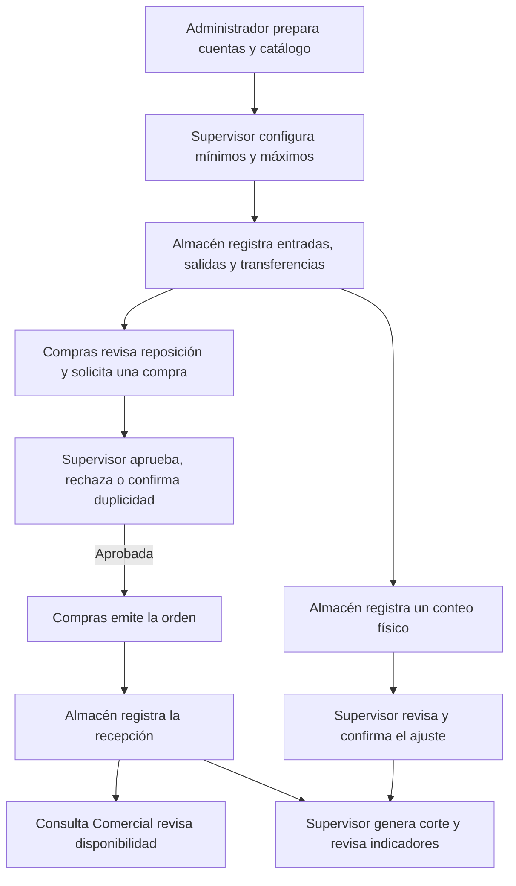

# Guía de uso de StockGuard MYPE

Esta guía explica las funciones de la aplicación y cómo se conectan durante el trabajo diario.
Está pensada para los integrantes del equipo, una persona que vaya a utilizar el sistema y la exposición.
Para instalarlo y arrancarlo, consultar primero [GUIA-INICIO.md](GUIA-INICIO.md).

## 1. Qué permite hacer el sistema

StockGuard controla productos, existencias por almacén, movimientos, compras y conteos físicos.
Con esas operaciones calcula recomendaciones de reposición e indicadores de inventario.

El recorrido habitual es:

Cada persona utiliza una cuenta con el rol que corresponde a su responsabilidad.

## 2. Qué hace cada rol

| Rol | Responsabilidad principal | Operaciones que le corresponden |
|---|---|---|
| Administrador | Organizar el sistema | Gestionar cuentas, productos y almacenes; consultar inventario, compras, reportes, indicadores, cortes, evidencias y estado del sistema. |
| Almacén | Registrar lo que ocurre físicamente | Entradas, salidas, transferencias, conteos y recepciones de compras; consultar sus registros y disponibilidad. |
| Compras | Tramitar las necesidades de compra | Revisar reposición, enviar solicitudes y emitir órdenes de solicitudes aprobadas; consultar catálogo, stock e historial. |
| Supervisor | Revisar y autorizar | Configurar políticas, decidir solicitudes, confirmar duplicidades, cancelar pendientes, confirmar ajustes, generar cortes y consultar indicadores. |
| Consulta Comercial | Consultar disponibilidad | Ver productos, almacenes, existencias, movimientos y reportes, sin registrar operaciones. |

Administrador gestiona las cuentas, pero las compras siguen el circuito Compras → Supervisor → Almacén.
Una cuenta tiene un solo rol. Para demostrar el circuito completo se cambia de usuario en cada etapa.
Los menús y botones disponibles dependen del rol; no todas las cuentas tienen el mismo panel inicial.

## 3. Cómo entrar y gestionar la cuenta

Abrir **http://localhost:4200**, ir a Iniciar sesión y escribir el usuario y la contraseña asignados.
El rol no es necesariamente el nombre de usuario: una cuenta llamada demo-compras, por ejemplo,
puede tener el rol Compras.

### Primer acceso

Si la cuenta tiene una contraseña temporal, la aplicación solicita cambiarla antes de entrar al panel.
Introducir la clave actual, una nueva y su confirmación. La nueva debe ser distinta, tener al menos
12 caracteres y no superar 72 bytes UTF-8; letras con tilde y otros símbolos pueden ocupar varios bytes.
Después se continúa en el área del rol usando la nueva contraseña.

En una instalación nueva los nombres predeterminados son administrador, almacen, compras,
supervisor y consulta-comercial. Sus claves las configura quien instala el sistema; no existe una
contraseña pública universal. En una base existente se conservan los usuarios y claves que ya tenía,
incluidos los demo-* si fueron creados anteriormente. No hace falta activar demo para utilizarlos.

### Mi cuenta

El enlace **Mi cuenta** permite cambiar voluntariamente la contraseña de cualquier rol indicando
la actual. Tras cambiarla, las sesiones anteriores quedan inválidas. Si alguien perdió su clave,
Administrador puede restablecer una temporal para esa otra cuenta desde Usuarios.

Cerrar sesión al terminar. Si aparece un aviso de sesión vencida o revocada, volver a iniciar sesión.
Si se pierde el acceso al único Administrador, hace falta una recuperación técnica controlada;
cambiar las claves iniciales del archivo de configuración no restablece una cuenta existente.

## 4. Qué hace cada función o pestaña

Algunos menús agrupan Reposición, Solicitudes y Órdenes dentro de **Compras**. Otros roles tienen
accesos separados. El nombre del contenedor cambia, pero se utiliza el mismo proceso.

| Función | Para qué sirve | Cómo se utiliza |
|---|---|---|
| Inicio / Panel | Mostrar un resumen permitido para el rol. | Usar los accesos a sus tareas. Un panel vacío puede corresponder a una instalación sin operaciones. |
| Usuarios | Crear y administrar cuentas del equipo. | Administrador crea cuentas y abre Detalle para editar, cambiar estado, restablecer clave o consultar Historial. |
| Mi cuenta | Cambiar la contraseña propia. | Escribir clave actual, nueva y confirmación. Disponible para todos los roles. |
| Productos | Mantener el catálogo. | Administrador registra SKU, categoría, marca, modelo, especificación y si es crítico. Los otros roles consultan. |
| Almacenes | Mantener las ubicaciones del inventario. | Administrador crea, edita o desactiva almacenes. Los otros roles consultan. |
| Existencias | Consultar las unidades disponibles. | Seleccionar producto y almacén, y pulsar Consultar. El saldo corresponde a esa combinación. |
| Movimientos / Entradas y salidas | Consultar el historial y registrar ingresos o consumos. | Almacén registra una entrada o salida con cantidad y motivo. Los otros roles autorizados consultan el historial. |
| Transferencias | Trasladar unidades entre almacenes. | Almacén elige producto, origen, destino distinto, cantidad y motivo. Se generan salida y entrada relacionadas. |
| Conteos físicos | Comparar lo contado con el saldo registrado. | Almacén registra la cantidad física. Supervisor revisa y confirma el ajuste si sigue vigente. |
| Políticas min/max | Definir límites de stock por producto y almacén. | Supervisor elige el par y guarda mínimo y máximo; el máximo debe superar al mínimo. |
| Reposición | Ayudar a decidir cuánto comprar. | Consultar stock, consumo, órdenes pendientes, punto de reposición y sugerencia. Compras puede preparar una solicitud. |
| Solicitudes de compra | Registrar y revisar una necesidad de compra. | Compras envía la solicitud. Supervisor aprueba, rechaza o confirma que duplica otra. |
| Órdenes y recepciones | Dar seguimiento a las compras aprobadas. | Compras emite la orden desde la solicitud aprobada. Se consulta lo ordenado, recibido y pendiente. |
| Registrar recepción | Registrar la llegada de una compra. | Almacén consulta la orden e indica cuántas unidades llegaron y su motivo. Puede recibir por partes. |
| Cancelar pendiente | Cerrar unidades de una orden que ya no se recibirán. | Supervisor abre una orden emitida con pendiente y cancela indicando motivo. Conserva lo recibido. |
| Cortes de stock | Guardar una fotografía del inventario para medirlo. | Supervisor genera el corte y conserva su identificador de lote. Administrador también puede consultar un lote conocido. |
| Reportes | Consultar rotación y stock crítico. | Elegir reporte, período y filtros. Stock crítico utiliza un corte del período. |
| Indicadores I05–I10 | Revisar los seis resultados operativos. | Supervisor o Administrador eligen período y filtros; Ver cálculo muestra los datos usados. |
| Evidencias técnicas | Consultar resultados de verificación guardados. | Administrador revisa alcance, fecha y versión. Esta pantalla no ejecuta otra vez las pruebas. |
| Estado del sistema | Comprobar disponibilidad del servicio y su conexión a la base. | Administrador o Supervisor consultan la respuesta y revisan un error si no está disponible. |

### Detalles al administrar cuentas

En **Usuarios → Detalle**, Administrador puede editar otra cuenta y asignarle un rol, activarla o
desactivarla, restablecer su clave temporal y consultar sus eventos. Los cambios administrativos
requieren motivo. Si otra persona ya editó la cuenta, recargar su información antes de intentarlo de nuevo.

Crear o restablecer una cuenta exige que su titular cambie la clave temporal al entrar. Restablecer
una contraseña no reactiva una cuenta desactivada. Editar o desactivar una cuenta invalida sus sesiones.
La propia cuenta del administrador utiliza Mi cuenta para su clave; no permite cambiarse de rol,
renombrarse ni desactivarse desde Usuarios. El historial conserva quién hizo el cambio y cuándo.

## 5. Flujo de inventario: crear, ingresar, consultar y trasladar

### A. Preparar el catálogo

1. Administrador crea el producto con un SKU único.
2. Verifica que el producto y los almacenes estén activos.
3. Supervisor configura mínimo y máximo para el producto en el almacén que se va a controlar.

Crear el producto registra su descripción. **No le asigna stock automáticamente.**

### B. Registrar una entrada o salida

1. Entrar como Almacén y abrir **Entradas y salidas**.
2. Elegir producto, almacén y tipo Entrada o Salida.
3. Escribir una cantidad entera positiva y un motivo que explique la operación.
4. Pulsar Registrar movimiento y revisar el resultado.
5. En Existencias, consultar ese producto en ese almacén.

Una entrada aumenta el saldo; una salida lo disminuye. El sistema rechaza una salida que dejaría
stock negativo. La cuenta que registra la operación queda identificada en el movimiento.
Para registrar otra operación tras un resultado confirmado, utilizar **Nueva operación**.

Al iniciar el inventario de una empresa, las unidades realmente disponibles pueden registrarse
como Entrada con motivo Saldo inicial. Una compra recibida utiliza Recepciones para conservar
su relación con la orden; no se registra además una entrada manual por esas mismas unidades.

### C. Transferir a otro almacén

En **Transferencias**, Almacén selecciona origen, destino distinto, producto, cantidad y motivo.
Si hay 12 unidades en A01 y se transfieren 3 a un A02 inicialmente vacío, quedan 9 en A01 y 3 en A02.
El total entre ambos sigue siendo 12. Los dos movimientos se confirman juntos y se consultan
desde el historial de Movimientos.

## 6. Flujo completo de reposición y compra

### Paso 1. Compras revisa Reposición

La recomendación combina los límites definidos por Supervisor, las salidas de consumo de los
últimos 30 días y las órdenes emitidas que todavía tienen unidades pendientes. El plazo y margen
predeterminados son 7 y 3 días. Estos parámetros y el umbral de aprobación son configurables.

Una cantidad sugerida de cero puede ser correcta aunque el stock físico sea bajo: puede haber
suficientes unidades en órdenes pendientes. Una solicitud todavía sin orden no cuenta como
suministro confirmado. Consultar una sugerencia no crea una compra ni cambia el inventario.

Si no aparece el par esperado, comprobar que producto/almacén estén activos y tengan una política.

### Paso 2. Compras envía la solicitud

Pulsar **Preparar solicitud** desde una sugerencia o **Nueva solicitud**. Completar producto,
almacén, cantidad, monto total estimado en soles y motivo. Cada solicitud corresponde a un producto
y un almacén. Si se declara urgente, explicar el motivo de urgencia.

Después del envío queda **Pendiente**. Revisar el detalle y las solicitudes similares que aparezcan.
La advertencia avisa de una posible duplicidad; no determina por sí sola que la compra sea incorrecta.

### Paso 3. Supervisor revisa y decide

Desde el detalle de una solicitud pendiente, Supervisor puede:

- **Aprobar:** autorizar la necesidad. Si el monto supera S/5000 con la configuración predeterminada,
  debe escribir una justificación adicional.
- **Rechazar:** indicar por qué no corresponde comprar.
- **Confirmar duplicidad:** indicar el ID de una solicitud original anterior, del mismo producto y
  almacén, y un motivo. La adicional queda rechazada y conserva la relación con la original.

Una decisión final no se vuelve a ejecutar. El sistema impide que una persona apruebe una solicitud
creada por su propia cuenta, incluso si después cambió de rol.

### Paso 4. Compras emite la orden

Abrir una solicitud **Aprobada** y pulsar **Emitir orden**. Se genera una sola orden interna para
esa solicitud. La coordinación y el pago al proveedor se realizan fuera de esta aplicación.
En esta etapa el stock todavía no aumenta.

### Paso 5. Almacén registra lo recibido

1. Abrir **Recepciones** o utilizar Registrar recepción desde una orden disponible.
2. Seleccionar o escribir el ID de la orden y pulsar **Consultar orden**.
3. Revisar producto, almacén y cantidad pendiente.
4. Escribir la cantidad que realmente llegó y su motivo.
5. Registrar la recepción y comprobar sus movimientos y el nuevo saldo.

Se permiten recepciones parciales. Si se ordenaron 10 y llegaron 4, quedan 6 pendientes. Al recibir
esas 6, la orden pasa a **Atendida**. No se permite recibir más de lo pendiente.

Si se pierde la conexión y el resultado es incierto, revisar el historial o usar **Reintentar la misma
recepción**. El reintento conserva su identificación y evita sumar otra vez la misma entrega.

### Paso 6. Cancelar lo que ya no llegará, cuando corresponda

Supervisor abre una orden **Emitida** con cantidad pendiente y pulsa **Cancelar pendiente**, con motivo.
Por ejemplo, si llegaron 3 de 10, se conservan las 3 recibidas y se cancelan las 7 restantes.
La orden queda **Cancelada** y no acepta otra recepción. El stock recibido no se revierte.

| Registro | Estados principales |
|---|---|
| Solicitud | Pendiente → Aprobada o Rechazada. Una duplicidad confirmada queda Rechazada. |
| Orden | Emitida → Atendida al completar la recepción, o Cancelada al cancelar el pendiente. |

## 7. Conteo físico y ajuste

1. Almacén abre Conteos físicos, elige producto/almacén y registra lo que contó, con su motivo.
2. El sistema guarda el saldo registrado en ese momento y la cantidad física observada.
3. Supervisor consulta los conteos pendientes, abre Detalle y compara ambos valores.
4. Si corresponde, pulsa **Confirmar ajuste**. La diferencia genera un ajuste de entrada o salida.
5. Si los valores ya coincidían, se confirma el conteo sin inventar un movimiento de diferencia cero.

**Registrar el conteo no modifica el stock.** El ajuste ocurre al confirmarlo Supervisor.
Si hubo movimientos después de contar, el sistema rechaza la confirmación y pide un conteo nuevo.
La coincidencia de inventario se mide con los valores observados al contar, no con el saldo ya corregido.

## 8. Cortes, reportes e indicadores

Supervisor genera un corte desde **Cortes de stock** y conserva el identificador del lote para
consultarlo después. El corte guarda una fotografía de cantidades, criticidad y políticas.
No aumenta ni disminuye existencias. La pantalla permite consultar un lote conocido; no lista todos los lotes.

En **Indicadores**, elegir período y, cuando sea útil, SKU y almacén. Las fechas se presentan en
horario de Lima y Hasta incluye el día completo. **Ver cálculo** permite revisar numerador,
denominador y resultado.

| Indicador | Qué permite comprobar |
|---|---|
| I05 · Quiebre | Porcentaje de productos críticos que tuvieron saldo cero en algún almacén observado durante el período. Un saldo final positivo no borra un quiebre previo. |
| I06 · Compras urgentes | Porcentaje de órdenes emitidas que fueron clasificadas como urgentes. |
| I07 · Coincidencia de inventario | Porcentaje de conteos cuya cantidad física coincidió con el saldo registrado al contar. |
| I08 · Tiempo de aprobación | Tiempo promedio, en días, desde el envío hasta la aprobación. Los segundos de base aparecen en el cálculo. |
| I09 · Solicitudes duplicadas | Porcentaje de solicitudes del período con duplicidad confirmada, no simplemente advertida. |
| I10 · Sobre el máximo | Porcentaje de productos críticos sobre su máximo en el corte seleccionado. |

I05 e I10 necesitan un corte dentro del período. I10 requiere políticas para los pares críticos
seleccionados. Para una demostración sencilla, configurar la política y filtrar ese SKU/almacén.
Si se consulta todo, deben estar completas las políticas de los pares críticos incluidos.
**Sin datos** significa que falta una base de cálculo; no equivale a 0%.

En Reportes, Rotación relaciona consumo de salidas y stock promedio del período. Stock crítico
consulta el corte del período; para el saldo actual utilizar Existencias.

## 9. Activos, inactivos e historial

Los selectores de almacén ofrecen activos por defecto. **Incluir inactivos** permite escoger también
almacenes desactivados para consultar su historia; llevan la etiqueta correspondiente. Al ocultarlos,
se limpia cualquier selección inactiva que hubiera quedado elegida.

Esta opción amplía las opciones del selector. Una consulta con Todos los almacenes sigue incluyendo
la historia global. Los formularios de operaciones nuevas, compras y políticas solo ofrecen activos.
Administración conserva los registros desactivados para que su historial pueda consultarse.

## 10. Ejemplo breve para practicar o exponer

Ejemplo didáctico con un producto de prueba y el almacén A01:

| Paso | Cuenta | Acción | Resultado esperado en A01 |
|---|---|---|---|
| 1 | Administrador | Crear el producto activo y marcarlo crítico. | Empieza sin unidades. |
| 2 | Supervisor | Guardar mínimo 5 y máximo 20. | La política queda preparada; stock sin cambios. |
| 3 | Almacén | Registrar entrada de 10 y salida de 6. | Quedan 4. |
| 4 | Compras | Consultar reposición sin órdenes previas pendientes y solicitar 16 unidades por S/6000. | La solicitud queda pendiente; siguen 4. |
| 5 | Supervisor | Aprobar con justificación por superar S/5000. | Queda aprobada; siguen 4. |
| 6 | Compras | Emitir orden. | Orden por 16 unidades; siguen 4. |
| 7 | Almacén | Recibir primero 6 y después 10. | Saldo 10 y luego 20; orden atendida. |
| 8 | Almacén / Supervisor | Contar 18 y confirmar el ajuste sin movimientos intermedios. | Quedan 18, con ajuste de salida de 2. |
| 9 | Supervisor | Generar corte y consultar indicadores del SKU y A01. | Resultados trazables a las operaciones realizadas. |
| 10 | Consulta Comercial | Consultar el producto en A01. | Ve 18 unidades, sin acciones de compra o ajuste. |

Los resultados de este ejemplo suponen que se empieza sin stock ni órdenes pendientes para ese par.
Con datos previos, las cantidades y los indicadores dependen de su historial.

Para explicarlo verbalmente: «Administrador prepara el catálogo y las cuentas. Supervisor define
los límites. Almacén registra las operaciones físicas. Compras solicita lo necesario y Supervisor
lo autoriza. Compras emite la orden y Almacén registra la llegada. Finalmente se contrasta el
inventario físico y se revisan indicadores con datos verificables».

## 11. Dudas y mensajes frecuentes

| Situación | Qué revisar o hacer |
|---|---|
| No aparece un botón o una pestaña. | Comprobar el rol de la cuenta. Las acciones se distribuyen por responsabilidad. |
| No hay productos o almacenes para seleccionar. | Administrador debe crear o revisar los registros activos del catálogo. |
| Creé un producto y muestra cero. | Crear su ficha no crea unidades. Registrar la entrada real o recibir una orden. |
| Hay stock en otro almacén, pero aquí aparece cero. | Cada combinación de producto y almacén tiene su propio saldo. Revisar ambos filtros. |
| La sugerencia de compra es cero. | Revisar stock, política, consumo y órdenes pendientes; puede haber suministro suficiente. |
| No puedo aprobar una solicitud. | Usar Supervisor, revisar que siga pendiente, la justificación por monto y que no sea propia. |
| La orden no permite recibir. | Comprobar que esté emitida, tenga pendiente y se esté usando Almacén. Consultar primero la orden. |
| El inventario cambió desde el conteo. | Registrar un conteo nuevo; no forzar el anterior. |
| Otra persona cambió la cuenta que estaba editando. | Cerrar el formulario, actualizar Usuarios y revisar los datos vigentes. |
| Veo Sin datos en indicadores. | Revisar período, corte, políticas y operaciones que aportan al indicador. |
| Perdí la contraseña. | Solicitar a otro Administrador un restablecimiento temporal. No existe recuperación pública por correo. |
| Aparece sesión vencida o revocada. | Iniciar de nuevo. Un cambio de clave, rol o estado puede invalidar la sesión anterior. |
| Aparecen nombres QA-* o demo-*. | Son registros de pruebas o demostración conservados de una base existente. No se renombran ni se eliminan automáticamente. |

## 12. Documentación para profundizar

- [Instalación y arranque](GUIA-INICIO.md).
- [Reglas y fórmulas detalladas](backend/docs/APF3/REGLAS-Y-MODELO.md).
- [Matriz de permisos y pestañas](frontend/docs/ROLES-PERMISOS-Y-PENDIENTES.md): la matriz sigue vigente; su diagnóstico inicial es histórico.
- [Cuentas y credenciales iniciales](backend/docs/APF3/cuentas/README.md).
- [Corrección de selectores e inactivos](frontend/docs/SELECTORES-ALMACENES.md).
- [Recorridos integrados y evidencia](backend/docs/APF3/revision-integrada/README.md).

Esta guía describe el uso funcional del sistema. Los contratos de programación y las evidencias
técnicas se conservan en sus documentos; para utilizar las pantallas no es necesario conocer los endpoints.
