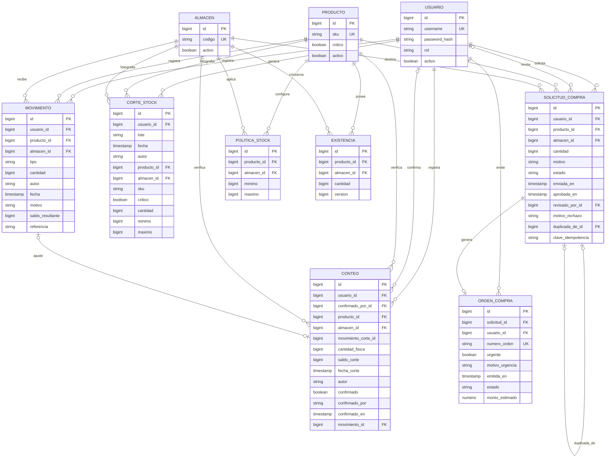

# Integración Angular implementada — 16 de noviembre de 2026

Se implementaron cuentas V8 y las áreas de Compras, Supervisor y Consulta Comercial sobre
la rama front. Pruebas Angular: 97 aprobadas; compilación de producción y TypeScript correctos.
Backend/PostgreSQL y revisión visual bloqueados por el entorno: los doce escenarios reales de
cuentas y F01–F05 siguen pendientes E2E. No se modificó el backend ni ninguna base de datos.
Detalle y evidencias: [INTEGRACION-FRONT-RESULTADOS.md](frontend/docs/INTEGRACION-FRONT-RESULTADOS.md).
El usuario autorizó organizar la entrega en cuatro commits y publicarla en la rama front.

Las secciones siguientes conservan el diagnóstico previo; el estado de implementación Angular
vigente para esta revisión es el del informe enlazado. La matriz de permisos no cambia.

---

# Actualizacion vigente - cuentas y roles - 16 de noviembre de 2026

Rama actual: front. Backend ampliado; no se cambiaron los permisos operativos de los cinco roles.
No se agrega SUPERADMIN. Administrador gestiona cuentas; Compras solicita/emite; Supervisor
decide; Almacen recibe/mueve; Consulta comercial consulta los recursos autorizados.

- Flyway V8 agrega ciclo de vida de cuentas, revocacion de sesiones y auditoria.
- Instalacion nueva: cinco cuentas iniciales, passwords privados distintos y cambio obligatorio;
  arranque normal sin activar demo. No se agregan productos ni operaciones de prueba.
- Bases existentes: conserva nombres, hashes, roles y estado. No recrea ni resetea cuentas.
- Todos los roles tienen Mi cuenta y cambio de password. Administrador gestiona otras cuentas,
  con version, motivo e historial. No puede desactivarse/cambiar su rol a si mismo.
- La base local del usuario no fue migrada ni modificada durante esta implementacion.
  V8 se aplicara cuando el equipo arranque esta version contra su base; antes, hacer backup.
- La interfaz actual tiene areas de Administrador y Almacen; Compras, Supervisor y Consulta
  necesitan completarse. Primer acceso y nuevas acciones de cuentas tampoco estan implementados en Angular.
- Los JWT de la version anterior requieren iniciar sesion nuevamente.

Lectura para continuar:
1. [Instalacion y operacion de cuentas](backend/docs/APF3/cuentas/README.md).
2. [Contrato exacto Angular](backend/docs/APF3/cuentas/CONTRATO-FRONTEND.md).
3. [Matriz de pestanas/acciones por rol](frontend/docs/ROLES-PERMISOS-Y-PENDIENTES.md).
4. [Cambios al informe](backend/docs/APF3/cuentas/CAMBIOS-INFORME.md).
5. [Validacion de esta ampliacion](backend/docs/APF3/cuentas/VALIDACION.md).

Las cifras y descripciones que siguen corresponden a cortes historicos. Para cuentas prevalece
esta seccion y la carpeta cuentas. Las mediciones de volumen del 13/11 se conservan como historial.

---

# Estado actualizado para APF3 - 13 de noviembre de 2026

La documentacion vigente esta en [backend/docs/APF3](backend/docs/APF3/README.md).
El contenido anterior, conservado debajo, describe el corte APF2 y contiene pendientes ya resueltos.

## Cambios de esta etapa

- Compras: solicitudes con monto/urgencia/idempotencia, similitudes, duplicidad confirmada,
  aprobacion/rechazo por supervisor, orden unica, recepciones parciales atomicas y cancelacion de pendiente.
- Roles oficiales: COMPRAS solicita/emite; SUPERVISOR decide; ALMACEN recibe/mueve.
- Reposicion: min/max + consumo comercial reciente + ordenes pendientes, con regla explicada.
- Indicadores I05-I10, dashboard agregado y evidencias tecnicas I01-I04 de alcance backend.
- Consultas de conteos, paginacion de rotacion en BD, saldos iniciales/cortes por lote.
- CORS para Angular, salud protegida y logs HTTP sin cuerpos ni tokens.
- V6/V7 agregan trazabilidad e idempotencia. Ahora hay 11 entidades de negocio, incluida recepcion_compra.
- Perfil prod separado de la importacion de secretos locales; demo es optativo.
- Scripts y datos para 10000 productos / 164840 filas nuevas de negocio, medicion y restauracion.
- Coleccion Postman y guia de cambios al informe.

## Validacion y siguientes pasos

Consultar [resultado.json](backend/docs/APF3/evidencias/resultado.json) para la ultima suite,
version, huella y matriz de permisos; [volumen.json](backend/docs/APF3/evidencias/volumen.json)
para los seis indicadores de control; y [restauracion.json](backend/docs/APF3/evidencias/restauracion.json)
para backups restaurados y contrastados. La validacion local usa PostgreSQL 18.1 y H2;
el compose historico conserva PostgreSQL 16.

Angular, flujos E2E desde navegador y despliegue HTTPS siguen pendientes del equipo.
La carga masiva se realizo en una base aislada. Durante el primer arranque, el antiguo import
incondicional hizo que Flyway ampliara tambien la base local existente de V5 a V7; no se cargo
alli el volumen ni se borraron registros. Se corrigio moviendo la importacion al perfil local
y se agrego una prueba de aislamiento del perfil prod.

No se configuraron servicios cloud. La entrega APF3 se comparte en la rama prueba. La conexion a InsForge puede hacerse
posteriormente siguiendo [OPERACION.md](backend/docs/APF3/OPERACION.md).

---

## Corte APF2 conservado como historial

# 📌 DOCUMENTO DE TRASPASO TÉCNICO Y ESTADO DEL PROYECTO (HANDOVER)
**Proyecto:** StockGuard MYPE por ByteElement — Sistema de Gestión de Inventarios y Reposición  
**Curso:** Desarrollo Web Integrado (100000ST61) — Universidad Tecnológica del Perú (UTP)  
**Equipo:** 5 integrantes  
**Rama activa de trabajo:** `prueba`  
**Fecha de corte:** Noviembre 2026  

---

## 1. 🎯 Contexto del Negocio y Problemática

### 1.1 El Caso de Negocio (Caso 05: StockGuard MYPE)
ByteElement es una distribuidora ficticia dedicada a la comercialización de componentes de hardware y periféricos de PC (memorias RAM, unidades SSD, tarjetas gráficas, procesadores, etc.).  
El sistema opera sobre una red de **3 almacenes físicos habilitados**:
* `A01`: Tienda principal
* `A02`: Depósito
* `A03`: Despacho

### 1.2 Línea Base Simulada y Dolencias Operativas
Antes de StockGuard, la empresa operaba con hojas de cálculo fragmentadas y aprobaciones informales por mensajería:
* **15%** de productos críticos sufría al menos un quiebre de stock semanal.
* **23%** de las compras se realizaba como urgencia.
* **89%** de exactitud entre inventario físico y registrado en sistema.
* **2.7 días** promedio para aprobar una solicitud de compra.
* **8%** de solicitudes de compra duplicadas.
* **11%** de productos críticos sobre el stock máximo permitido.

### 1.3 Los 10 Indicadores Comprometidos (Matriz de Consistencia)
* **Técnicos (Variable Independiente - Implementación):**
  * `I01`: Requisitos críticos aceptados (RF01–RF10).
  * `I02`: Contratos de API protegidos con seguridad RBAC.
  * `I03`: Flujos críticos E2E aprobados (F01–F05).
  * `I04`: Reglas críticas de negocio con pruebas aprobadas (RN01–RN08).
* **Operativos (Variable Dependiente - Desempeño del Negocio):**
  * `I05`: **Quiebre semanal** (`% productos críticos con saldo 0 en algún almacén activo`).
  * `I06`: **Compras urgentes** (`% órdenes emitidas como urgentes / total emitidas`).
  * `I07`: **Exactitud de inventario** (`% pares contados con cantidad física == saldo registrado al corte`).
  * `I08`: **Tiempo de aprobación** (`promedio en días desde enviada_en hasta aprobada_en`).
  * `I09`: **Solicitudes duplicadas** (`% solicitudes con duplicada_de_id no nulo`).
  * `I10`: **Productos sobre el máximo** (`% productos críticos con saldo > stock_maximo`).

---

## 2. 🏗️ Arquitectura Técnica y Stack Tecnológico

* **Lenguaje:** Java 21 (LTS)
* **Framework Backend:** Spring Boot 4.1.1
* **Persistencia:** Spring Data JPA + Hibernate ORM (con `hibernate.ddl-auto=validate`)
* **Control de Versiones de BD:** Flyway 12 (`V1` a `V5`)
* **Base de Datos Producción / Local:** PostgreSQL 16
* **Base de Datos para Testing:** H2 Database en modo compatibilidad PostgreSQL (`MODE=PostgreSQL`)
* **Seguridad:** Spring Security 6 + OAuth2 Resource Server (JWT con HMAC-SHA256 y expiración a 30 min) + BCrypt
* **Pruebas Automatizadas:** JUnit 5, Mockito (con `mock-maker-subclass`), MockMvc, Spring Security Test
* **Frontend (Planificado para APF3):** Angular + SASS

---

## 3. 🗄️ Modelo de Datos Relacional Completo (10 Entidades)

El modelo está normalizado en PostgreSQL con claves foráneas estrictas (sin `ON DELETE CASCADE`), restricciones `CHECK` y claves compuestas únicas:



### Historial de Migraciones Flyway (`backend/src/main/resources/db/migration`):
1. `V1__crear_producto.sql`: Catálogo de hardware con SKU normalizado (`UPPER(BTRIM(sku))`).
2. `V2__crear_almacen_y_politica_stock.sql`: Almacenes (A01–A03) y políticas min/max (`minimo >= 0`, `maximo > minimo`).
3. `V3__inventario_seguridad_y_conteos.sql`: Tablas de saldo (`existencia` con versionamiento), kardex (`movimiento`), auditoría física (`conteo`), snapshots (`corte_stock`) y seguridad (`usuario`).
4. `V4__relacionar_usuarios_con_operaciones.sql`: Claves foráneas obligatorias desde movimientos, conteos y cortes hacia `usuario(id)`, manteniendo nombres históricos.
5. `V5__crear_solicitudes_y_ordenes_compra.sql`: Tablas `solicitud_compra` y `orden_compra` para el ciclo completo de reposición, idempotencia y detección de duplicadas.

---

## 4. 🔐 Seguridad, Autenticación y Matriz RBAC

Todos los endpoints usan el prefijo `/api/v1`. La autenticación se realiza vía `POST /api/v1/auth/login`, devolviendo un Bearer JWT de 30 minutos firmado con HS256.

### Matriz de Roles y Permisos en el Servidor:
| Operación / Endpoint | ALMACEN | COMPRAS | SUPERVISOR | CONSULTA_COMERCIAL | ADMINISTRADOR |
|---|:---:|:---:|:---:|:---:|:---:|
| Consultar catálogo, almacenes y existencias |  Sí |  Sí |  Sí |  Sí |  Sí |
| Crear / editar / desactivar productos o almacenes | ❌ No | ❌ No | ❌ No | ❌ No |  Sí |
| Administrar usuarios (`/usuarios`) | ❌ No | ❌ No | ❌ No | ❌ No |  Sí |
| Registrar ENTRADA / SALIDA / TRANSFERENCIA |  Sí | ❌ No | ❌ No | ❌ No | ❌ No |
| Registrar CONTEO físico de inventario |  Sí | ❌ No | ❌ No | ❌ No | ❌ No |
| Confirmar ajustes de inventario | ❌ No | ❌ No |  Sí | ❌ No | ❌ No |
| Generar Cortes de Stock (`/cortes-stock`) | ❌ No | ❌ No |  Sí | ❌ No | ❌ No |
| Consultar Indicadores y Reportes JPQL | ❌ No | ❌ No |  Sí | ❌ No |  Sí |
| Configurar Políticas de Stock (min/max) | ❌ No | ❌ No |  Sí | ❌ No | ❌ No |
| Crear solicitudes de reposición (RF04) |  Sí |  Sí | ❌ No | ❌ No | ❌ No |
| Aprobar / rechazar solicitudes y emitir órdenes (RF05) | ❌ No | ❌ No |  Sí | ❌ No | ❌ No |

---

## 5. ⚡ Mecanismos Transaccionales Críticos (Trazabilidad y Concurrencia)

1. **Orden de Bloqueo Anti-Deadlock:**  
   En `InventarioService`, toda mutación bloquea primero el `Producto` mediante `LockModeType.PESSIMISTIC_WRITE`. Luego, en transferencias entre almacenes, bloquea los almacenes en orden ascendente de ID (`Math.min(orig, dest)` y luego `Math.max(orig, dest)`). Esto evita bloqueos mutuos (*deadlocks*) entre hilos simultáneos.
2. **Atomicidad de Transferencia:**  
   Se persisten dos registros en `movimiento` (`TRANSFERENCIA_SALIDA` en origen y `TRANSFERENCIA_ENTRADA` en destino) que comparten la misma `referencia` (UUID). Si ocurre una falla en cualquier extremo, `@Transactional` revierte ambos saldos y movimientos.
3. **Bloqueo Optimista en Existencia:**  
   La entidad `Existencia` utiliza `@Version private Long version;` previniendo actualizaciones perdidas si múltiples transacciones leen el mismo saldo.
4. **Idempotencia de Ajuste en Conteos:**  
   Un conteo físico registra `movimientoCorteId`. Si entre el conteo y la confirmación del supervisor ocurrió algún movimiento intermedio, la confirmación se rechaza con `409 Conflict` por obsolescencia. Asimismo, una segunda confirmación es rechazada inmediatamente.

---

## 6. 🚀 Guía de Inicio Rápido: Cómo Levantar el Proyecto tras un `git pull`

Si tú, otro compañero o una IA clonan o hacen `git pull` del repositorio, sigue estos pasos:

### Paso 1: Asegurar Prerrequisitos
* Java 21 instalado (`java -version`).
* Docker Desktop activo (o una instancia local de PostgreSQL 16 corriendo en el puerto 5432).

### Paso 2: Base de Datos PostgreSQL
Desde la raíz del repositorio, levanta el contenedor oficial de PostgreSQL:
```powershell
docker compose up -d db
```
*(O si usas tu propio PostgreSQL local, crea una base llamada `stockguard` o `byteelement`).*

### Paso 3: Configurar Secretos Locales
En `backend/`, copia la plantilla de configuración local:
```powershell
Copy-Item backend/application-local.properties.example backend/application-local.properties
```
Abre `backend/application-local.properties` y define tus contraseñas locales (este archivo está en `.gitignore` y **no se sube a GitHub**):
```properties
spring.datasource.url=jdbc:postgresql://localhost:5432/byteelement
spring.datasource.username=postgres
spring.datasource.password=admin
stockguard.jwt.secret=clave_secreta_super_segura_de_mas_de_32_caracteres_12345
stockguard.bootstrap.username=administrador
stockguard.bootstrap.password=REEMPLAZAR_CON_SECRETO_LOCAL_ALEATORIO
stockguard.demo.password=OtraREEMPLAZAR_CON_SECRETO_LOCAL_ALEATORIO
```

### Paso 4: Ejecutar las Pruebas Automatizadas
Verifica que todo el backend compile y apruebe las 58+ pruebas unitarias y de integración:
```powershell
cd backend
.\mvnw.cmd test
```
*Resultado esperado:* `BUILD SUCCESS`.

### Paso 5: Iniciar el Servidor Backend
```powershell
.\mvnw.cmd spring-boot:run
```
Al arrancar, Flyway aplicará automáticamente las migraciones `V1` a `V5`, y Hibernate validará las 10 entidades. Verás:  
`Started StockguardApplication in X.XX seconds`.

### Paso 6: Ejecutar la Suite de Validación Automatizada APF2
Con el servidor corriendo en una terminal, abre **otra terminal** y ejecuta:
```powershell
.\backend\docs\APF2\Verificar-APF2.ps1
```
Este script ejecuta de principio a fin **23 pruebas HTTP automatizadas** con colores:
* Autenticación JWT de 3 roles.
* Matriz negativa de seguridad (401, 403).
* Creación de producto y catálogo.
* Entrada de inventario, transferencia atómica y saldos.
* Paginación JPQL.
* Conteo físico, ajuste de supervisor y rechazo de doble confirmación.
* Generación de corte de stock por lote.
* Cálculo en tiempo real de indicadores I05, I07, I10.
* Reportes de rotación y stock crítico.

---

## 7. 📁 Estructura del Repositorio y Carpetas de Documentación

```text
ByteElement-DWI/
├── backend/
│   ├── docs/
│   │   ├── APF1/                     # Evidencias, colecciones y scripts históricos de entrega 1
│   │   │   ├── APF1-RESUMEN-EVIDENCIAS.md
│   │   │   ├── CIERRE-APF1-GUIA-COMPLETA.md
│   │   │   ├── StockGuard-APF1.postman_collection.json
│   │   │   ├── Verificar-APF1.ps1
│   │   │   └── ... (logs de TDD y verificación APF1)
│   │   │
│   │   ├── APF2/                     # Documentos oficiales de entrega 2
│   │   │   ├── APF2-MINIMO.md        # Guía oficial de endpoints, permisos y fórmulas
│   │   │   ├── APF2-MODELO.md        # Diagrama de clases/relacional Mermaid
│   │   │   ├── APF2-VALIDACION.md    # Reporte de 58 pruebas automáticas aprobadas
│   │   │   ├── StockGuard-APF2.postman_collection.json
│   │   │   └── Verificar-APF2.ps1    # Script PowerShell con 23 pruebas visuales
│   │   │
│   │   └── referencias/              # Documentos Word base del curso y del caso
│   │       ├── AvanceProyectoDWI (3).docx
│   │       └── Banco_10_Casos_Proyecto_Desarrollo_Web_Integrado_UTP_100000ST61_FINAL (1).docx
│   │
│   ├── src/main/java/com/byteelement/stockguard/
│   │   ├── config/                   # Carga de datos demo (DatosDemo.java) y WebMvc
│   │   ├── controller/               # REST Controllers (/auth, /productos, /almacenes, /movimientos, /conteos, /cortes-stock, /indicadores, /reportes)
│   │   ├── dto/                      # Records inmutables con Bean Validation
│   │   ├── entity/                   # Las 10 entidades JPA (Producto, Almacen, Existencia, Movimiento, Conteo, CorteStock, Usuario, SolicitudCompra, OrdenCompra, etc.)
│   │   ├── exception/                # SkuDuplicadoException, SaldoInsuficienteException, ConflictoCatalogoException
│   │   ├── repository/               # 10 interfaces Spring Data JPA con JPQL
│   │   ├── seguridad/                # JwtService, SecurityConfig, BootstrapAdmin
│   │   └── service/                  # Lógica transaccional de catálogo, inventario, reportes y usuarios
│   │
│   ├── src/main/resources/
│   │   ├── application.properties    # Configuración global
│   │   └── db/migration/             # Migraciones Flyway V1, V2, V3, V4 y V5
│   │
│   ├── application-local.properties  # Secretos locales (en .gitignore)
│   └── pom.xml
│
├── .gitignore                        # Protege application-local.properties, target, IDEs
├── compose.yaml                      # Contenedor PostgreSQL 16
└── README.md
```

---

## 8. 🗺️ Próximos Pasos (Hoja de Ruta para la siguiente etapa: APF3 / PROY)

Cualquier IA o desarrollador que retome el proyecto debe concentrarse en:

1. **Backend - Módulo de Reposición y Compras (RF04 y RF05):**
   * Ya existen las entidades JPA (`SolicitudCompra`, `OrdenCompra`), sus repositorios y las tablas en BD (V5).
   * *Pendiente:* Crear `SolicitudCompraService`, `OrdenCompraService`, sus DTOs y controladores REST:
     * `POST /api/v1/solicitudes-compra`: Registro de solicitud con detección de similares y clave de idempotencia (RF04).
     * `POST /api/v1/solicitudes-compra/{id}/aprobar`: Decisión exclusiva del supervisor, emisión de la orden interna de compra (RF05).
     * `POST /api/v1/solicitudes-compra/{id}/rechazar`: Rechazo con motivo.
     * Conectar cálculo de indicadores `I06` (urgencias), `I08` (tiempo aprobación) e `I09` (duplicadas).
2. **Frontend - Aplicación Angular (Semana 11-15 / APF3):**
   * Configurar Angular CLI en la carpeta `frontend/`.
   * Estructura modular: `core/` (servicios HTTP, AuthGuard, Interceptor JWT), `shared/` (componentes comunes, navbar, modales, pipes), `features/` (catálogo, kardex/movimientos, conteos, órdenes de compra, dashboard de indicadores con gráficos).
   * Integración de estilos con SASS.
3. **Despliegue e Integración Final (Semana 16-18 / PROY):**
   * Dockerfile multi-stage para backend y frontend.
   * Despliegue en la nube (ej. Render, Railway, Google Cloud Run).
   * Demostración E2E de la hipótesis: reducción de quiebres y aumento de exactitud.
