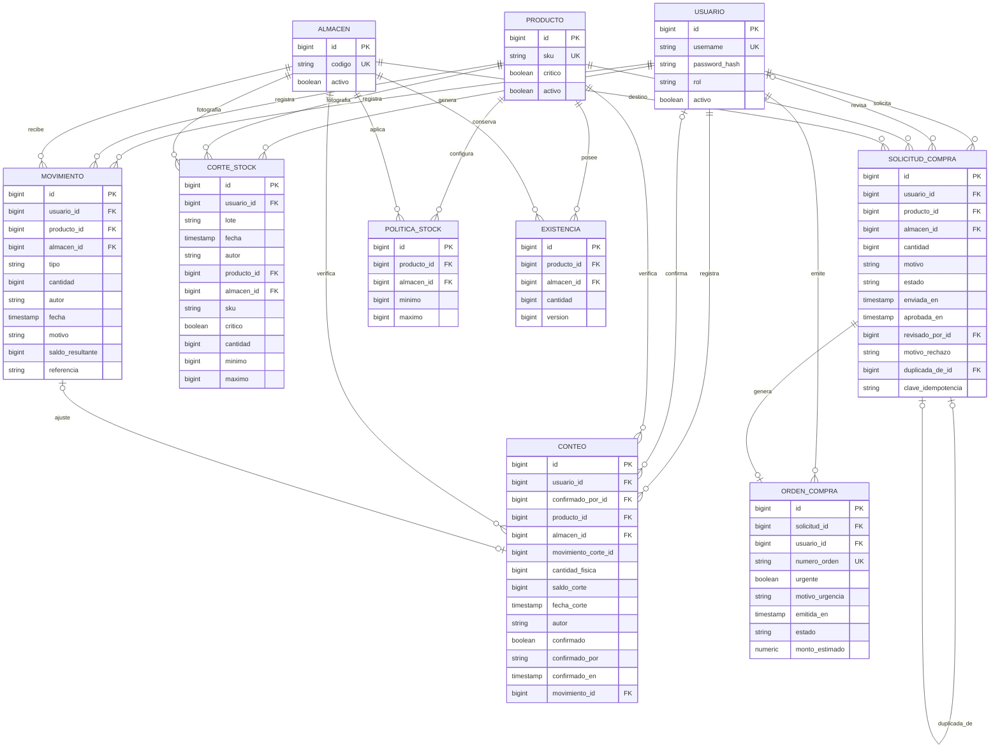

# Modelo relacional APF2

`usuario` almacena id, username único, password_hash BCrypt, rol y activo. Las cuatro claves foráneas vinculan las operaciones al usuario autenticado y al supervisor que confirma. La auditoría conserva además los nombres como texto histórico para que un cambio posterior de cuenta no cambie el nombre registrado. El rol del JWT se contrasta con el usuario actual en cada solicitud.

Claves compuestas únicas: politica_stock(producto_id,almacen_id), existencia(producto_id,almacen_id) y corte_stock(lote,producto_id,almacen_id). No hay endpoints de borrado físico de movimientos, conteos ni cortes.

Las transferencias enlazan sus dos movimientos mediante la misma referencia UUID. Los ajustes enlazan el conteo al movimiento generado; movimiento_corte_id es un marcador del último movimiento al registrar el conteo y permite detectar que hubo operaciones posteriores incluso si el saldo final coincide.

Las migraciones SQL V1–V4 constituyen el modelo físico. Los movimientos operativos se representan como entidades `MovimientoPersistido`; el record `Movimiento` conserva el contrato de salida del prototipo APF1.

La migración V4 añade las relaciones sin modificar V1–V3 y vincula los registros previos por coincidencia exacta de `autor` / `confirmado_por` con `usuario.username`. Los autores son obligatorios; `confirmado_por_id` es nulo hasta confirmar y obligatorio al confirmar. Las FK no usan ON DELETE CASCADE: la base impide eliminar usuarios referenciados por el historial.
