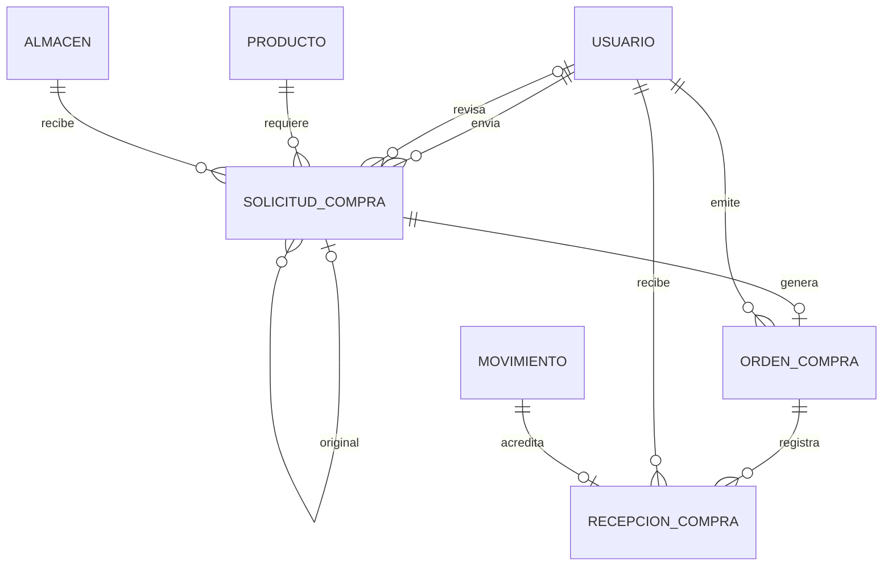

# Reglas y modelo APF3

Las siguientes reglas son decisiones del escenario academico acordadas con el responsable del
backend. No representan politicas reales validadas con ByteElement ni valores impuestos por el profesor.

## Catalogo e inventario

SKU normalizado y unico; minimo >= 0 y maximo > minimo. Historial conservado mediante desactivacion.
Entradas, salidas y transferencias registran actor del JWT, fecha del servidor y motivo.
Una salida nunca deja saldo negativo. Transferencia confirma ambos extremos o revierte todo.
Los conteos conservan saldo y ultimo movimiento al corte; el supervisor confirma una sola vez y
solo si el inventario no cambio. La comparacion I07 utiliza el saldo anterior al ajuste.

## Reposicion RF03

Por producto/almacen con politica y catalogo activo:

1. Consumo = suma de SALIDA de los ultimos 30 dias; excluir ajustes y transferencias.
2. Consumo diario = consumo / 30. Plazo de suministro = 7 dias; margen = 3 dias.
3. Pendientes = cantidad ordenada menos recibida de ordenes EMITIDA; excluir canceladas y atendidas.
4. Posicion = stock + pendientes.
5. Punto = min(maximo, max(minimo, ceil(consumo / 30 * (7 + 3)))).
6. Si posicion <= punto, sugerir max(0, maximo - posicion); en otro caso sugerir 0.

Ejemplo: minimo 10, maximo 100, stock 12, pendientes 20 y consumo 120 en 30 dias.
Consumo diario 4, punto 40, posicion 32, sugerencia 68 unidades.
El stock fisico puede estar bajo el minimo y aun asi no requerir otra compra si hay suficientes pedidos pendientes.
Las solicitudes sin orden emitida no son suministro confirmado: se advierten como similares.

La respuesta muestra periodo exacto, regla V1, entradas del calculo, estado y urgencia sugerida.
Sin salidas registradas funciona como min/max; esto no acredita que exista un historial completo de demanda.
La urgencia sugerida es stock cero o cobertura de stock menor al plazo de suministro.
La clasificacion efectiva se declara en la solicitud, requiere motivo y se conserva tras aprobacion.
El sistema no envia compras automaticamente a proveedores.

Parametros globales: stockguard.reposicion.ventana-dias, plazo-dias y seguridad-dias.
Cambiar parametros afecta recomendaciones futuras, no las politicas guardadas en cortes anteriores.

## Solicitud, decisiones y recepcion

COMPRAS envia solicitud con cantidad y monto positivo (soles, monto total estimado).
Solo SUPERVISOR aprueba/rechaza; nunca aprueba una solicitud propia.
Monto > S/5000 requiere justificacion adicional no vacia. Umbral configurable:
stockguard.compras.umbral-justificacion. No se modifica cantidad, monto ni urgencia despues del envio.
La correccion se tramita rechazando y enviando otra solicitud con otra clave.
Estados: PENDIENTE -> APROBADA o RECHAZADA. Una decision final impide otra.
Solicitud historica sin monto valido no puede aprobarse.

COMPRAS emite una orden interna por solicitud aprobada. Reintentar emision devuelve la orden existente.
Hay bloqueo transaccional y unicidad en BD. Crear/emitir no modifica inventario.
ALMACEN registra recepciones parciales; cada recepcion genera exactamente una ENTRADA y conserva
FK al movimiento y actor. Inventario, cantidad recibida y recepcion se confirman juntos.
La suma recibida no puede superar lo ordenado. Al completar pasa a ATENDIDA.
SUPERVISOR puede cancelar el pendiente de una EMITIDA con motivo; lo recibido no se revierte.

Idempotencia de envio: clave obligatoria por usuario. Igual clave y contenido devuelve la respuesta
de creacion conservada; contenido distinto produce 409. GET devuelve el estado actual.
Idempotencia de recepcion: clave obligatoria por orden; mismo contenido no agrega otra entrada.

## Similitudes y duplicidades

Al enviar, advertir solicitudes del mismo SKU/almacen enviadas en los ultimos 7 dias,
pendientes o aprobadas sin orden, sin duplicidad confirmada. La advertencia no bloquea una necesidad legitima.
SUPERVISOR puede confirmar una solicitud PENDIENTE como duplicada de otra anterior del mismo
producto/almacen. Original no puede ser duplicado. La adicional pasa a RECHAZADA y conserva
original, actor, fecha y motivo. No hay cadenas ni autorreferencia.
La confirmacion documentada puede relacionar solicitudes mas antiguas que la ventana de advertencia.
Reintentos idempotentes no son solicitudes adicionales ni aumentan I09.

## Indicadores I05-I10

Todos usan desde inclusivo y hasta exclusivo, con filtros SKU y almacen opcionales.
Sin denominador: valor=null y sinDatos=true; nunca se inventa un cero medido.

| Codigo | Numerador | Denominador | Periodo |
|---|---|---|---|
| I05 | Productos criticos con saldo cero en algun almacen observado durante el periodo | Productos criticos distintos del corte de cierre | Movimientos del periodo y saldo inicial reconstruido |
| I06 | Ordenes emitidas urgentes | Todas las ordenes emitidas | emitidaEn; incluye las canceladas despues, porque fueron emitidas |
| I07 | Observaciones de conteo con fisica = saldoCorte | Conteos del periodo | fechaCorte; reiterar un par en otro corte es otra observacion |
| I08 | Suma de duraciones en segundos | Solicitudes aprobadas | aprobadaEn; resultado = segundos / cantidad / 86400 |
| I09 | Solicitudes con duplicidad confirmada | Solicitudes enviadas | enviadaEn; confirmacion conocida al consultar |
| I10 | Productos criticos distintos sobre el maximo en algun almacen | Productos criticos distintos del corte | Ultimo corte dentro del periodo |

I05/I10 congelan la poblacion segun el corte de cierre y no duplican productos entre almacenes.
Sin corte dentro del periodo no se infiere poblacion historica. I10 exige politica en cada par
critico seleccionado. El corte conserva SKU, criticidad y limites para que editar el catalogo no reescriba resultados.
Una medicion semanal debe enviarse con los limites de esa semana convertidos desde America/Lima a UTC.
I08 devuelve unidad dias; numerador es segundos enteros informativos, valor usa precision subsegundo.
I09 es retrospectivo: confirmar una duplicidad posteriormente puede cambiar un periodo anterior.

## Modelo actualizado

V6 agrega monto/urgencia/revision/auditoria de duplicidad a solicitud_compra; recepciones y cancelacion
a orden_compra; unicidad (usuario_id, clave_idempotencia); y recepcion_compra.
V7 agrega respuesta de creacion idempotente e indice de conteos.
Son 11 entidades de negocio; flyway_schema_history es una tabla tecnica adicional.

RN01 saldo no negativo; RN02 transferencia atomica; RN03 limites min/max;
RN04 similitud e idempotencia; RN05 decision por rol/monto y orden unica;
RN06 recomendacion con consumo y pendientes; RN07 conteo y ajuste autorizado;
RN08 recepcion atomica, idempotente y limitada a cantidad pendiente.
Esta numeracion concreta las ocho reglas mencionadas, pero no detalladas, en el informe anterior.
