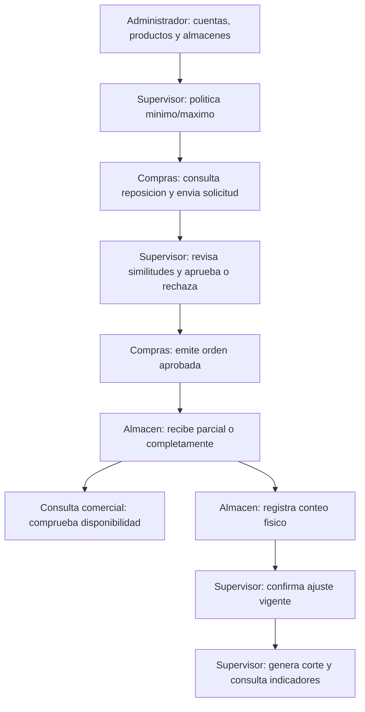
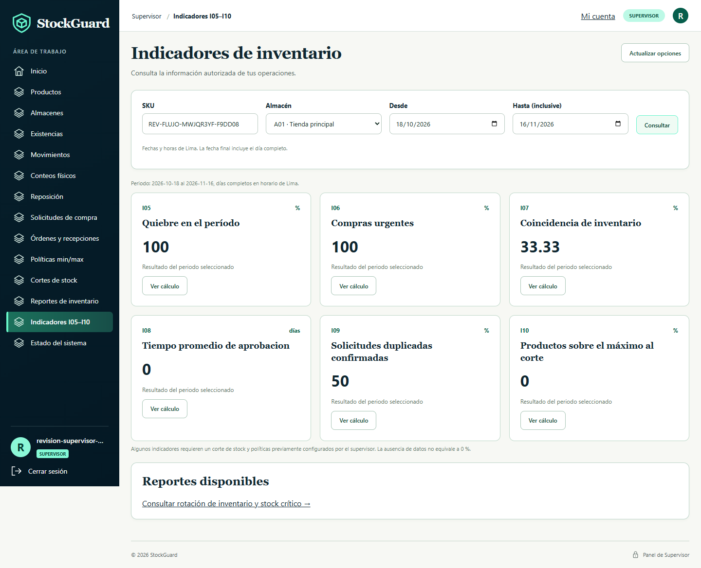

# Revision del flujo completo con Angular y PostgreSQL

Fecha: 16 de noviembre de 2026. Rama front, base de trabajo 4ef548c.
Esta revision ejecuta la interfaz integrada con el backend real. Complementa las evidencias
anteriores de backend y reemplaza el pendiente general de recorridos locales F01-F05 del
informe de integracion Angular. No acredita un despliegue cloud ni todos los casos posibles.

## Resultado comprobado

| Verificacion | Resultado | Evidencia |
|---|---|---|
| Backend en H2 modo PostgreSQL | 94 pruebas, sin fallos, errores u omitidas | [resultado-h2.json](evidencias/resultado-h2.json) |
| Backend en PostgreSQL 18.1 | 94 pruebas, sin fallos, errores u omitidas | [resultado-postgresql.json](evidencias/resultado-postgresql.json) |
| Autorizacion | 49 contratos protegidos; todos los grupos aprobados | seguridad[] de los reportes |
| Angular con Node 24.22.1 | 97 pruebas en 12 archivos, todas aprobadas | [angular-tests.log](evidencias/angular-tests.log) |
| Angular produccion | Compilacion correcta | [angular-build.log](evidencias/angular-build.log) |
| Chromium + Angular + Spring + PostgreSQL | 20 grupos de escenarios aprobados, sin errores JavaScript no controlados | [navegador.json](evidencias/navegador.json) |
| Migracion de una copia real V7 -> V8 | Seis cuentas y datos conservados | [migracion-copia.json](evidencias/migracion-copia.json) |
| Base original byteelement | Consultas de solo lectura; sigue en V7, sin cambios en cuentas o conteos | [base-original.json](evidencias/base-original.json) |

En la suite PostgreSQL, UsuarioMigrationTest y PerfilProduccionIntegrationTest mantienen sus
escenarios H2. Principal, demo e instalacion usan tres bases PostgreSQL de pruebas distintas.
Los reportes registran commit base, cambios locales y huella de las fuentes. Se agregaron dos
pruebas: rechazo de un JWT firmado anterior a V8 sin uid/ver y proteccion al reutilizar un nombre
que ahora corresponde a otra cuenta. No fue necesario modificar permisos ni codigo productivo.

La prueba de navegador usa formularios/botones reales. Las comprobaciones complementarias
leen API/SQL y reenvian una recepcion con la misma clave para verificar idempotencia. No se
simularon respuestas del servidor. El runner observa copias de las respuestas fetch sin modificar
su contenido. Script reproducible y limites en [frontend/e2e](../../../../frontend/e2e/README.md).

## Que ocurre con la base que ya tienes

Se consulto localhost:5432/byteelement con transacciones de solo lectura. Estado observado:

| Dato | Cantidad |
|---|---:|
| Cuentas activas | 6 |
| Productos | 22 |
| Almacenes | 6 |
| Registros de existencia | 17 |
| Movimientos | 32 |
| Conteos fisicos | 9 |
| Solicitudes / ordenes de compra | 0 / 0 |

Las cuentas son administrador, demo-administrador, demo-almacen, demo-compras, demo-supervisor
y demo-consulta_comercial. Cubren los cinco roles; hay dos administradores. No es una base vacia.
Sus passwords no se publican. El nombre demo no cambia los permisos ni significa que haya que
activar el perfil demo para utilizarlas: son filas persistidas y siguen existiendo al reiniciar.

El ensayo se hizo con pg_dump/pg_restore hacia una base separada del puerto 55432. Al iniciar
el backend sobre esa copia, Flyway aplico V8; nombres, hashes, roles, estados y conteos quedaron
iguales. El administrador existente pudo iniciar sesion. Se dejaron vacios los cinco secretos de
bootstrap en ese arranque para verificar que no son necesarios en una instalacion ya provisionada.

En tu proximo arranque normal contra byteelement, Flyway aplicara V8. No debes borrar la base,
recrear usuarios ni activar local,demo. Conserva una copia de respaldo antes de actualizarla.
V8 no obliga retroactivamente a cambiar claves existentes: las cuentas nuevas y los resets si
exigen ese cambio. Para las actuales, Mi cuenta permite cambiar su password voluntariamente.
Los JWT anteriores dejan de servir: iniciar sesion de nuevo. Cambiar el archivo de configuracion
no restablece passwords que ya estan guardados en la base.

## Dos condiciones de tu entorno

1. En la primera revision el Node global era 24.13.0 y Angular lo rechazaba. El usuario ya lo
   actualizo a Node 26.13.1 / npm 11.20.0. La CLI lo acepta y se repitieron las 97 pruebas y el
   build correctamente; evidencia en node26-tests.log y node26-build.log. La prueba integrada
   anterior uso Node 24.22.1. Las versiones admitidas estan en frontend/package.json.
2. Abrir http://localhost:4200. Ese es el origen CORS predeterminado. Usar 127.0.0.1:4200
   produce un origen distinto y fue rechazado con 403. Para otro origen, configurarlo
   explicitamente mediante CORS_ORIGINS y reiniciar el backend.

No se cambio la instalacion global de Node ni la configuracion privada del usuario. Para instalar
dependencias en el entorno de revision se usaron los certificados de confianza de Windows;
no se desactivo TLS. Los servidores temporales se detienen al terminar la revision.

## Flujo para explicar en la exposicion



Cada persona entra con su propia cuenta. Una cuenta nueva cambia primero su clave temporal;
despues entra a su area. Administrador no solicita ni aprueba compras como superusuario.
La separacion se verifico con guards y con rechazos reales del servidor.

Ejemplo ejecutado con un producto sintetico exclusivo:

1. Administrador crea el producto; Supervisor configura minimo 5 y maximo 20.
2. Almacen registra entrada 10 y salida 3: quedan 7. Salida 999 se rechaza con 409 y conserva 7.
3. Almacen transfiere 2: quedan 5 en origen y 2 en destino. Ambos movimientos comparten referencia.
4. Compras solicita 10 unidades, S/6000, urgente con motivo. Otra solicitud similar genera
   advertencia; Supervisor confirma la duplicidad y queda rechazada con relacion al original.
5. Aprobar S/6000 sin justificacion devuelve 400. Con justificacion se aprueba y registra fecha/actor.
6. Compras emite la orden. Almacen recibe 4 y despues 6: quedan 15 en el origen. Repetir la
   primera recepcion con su misma clave no suma stock. Intentar recibir 7 cuando faltan 6
   se bloquea en la interfaz sin enviar la escritura.
7. Un conteo queda obsoleto tras una entrada adicional y su confirmacion devuelve 409, conservando
   saldo 16. Un conteo nuevo de 13 se confirma y ajusta a 13. Otro conteo registra coincidencia.
8. Supervisor genera un corte; filtra SKU, almacen y periodo. Consulta comercial ve stock 13
   y no puede abrir compras ni administrar usuarios.

En un segundo producto se recibieron 3 de 10 y se cancelaron las 7 pendientes: lo recibido
se conservo, y otra recepcion sobre la orden cancelada devolvio 409.

Tambien se probaron ediciones simultaneas con 409, renombrado y revocacion, reset temporal,
historial sin claves, desactivacion/reactivacion y cambio voluntario desde Mi cuenta.

## Indicadores observados en el escenario filtrado

| Indicador | Numerador | Denominador | Resultado |
|---|---:|---:|---:|
| I05 | 1 producto con quiebre en el periodo | 1 producto critico | 100% |
| I06 | 1 orden urgente | 1 orden | 100% |
| I07 | 1 conteo coincidente | 3 conteos | 33.33% |
| I08 | Segundos reales de envio a aprobacion | 1 aprobacion | Ver JSON; dias redondeados |
| I09 | 1 solicitud duplicada confirmada | 2 solicitudes | 50% |
| I10 | 0 productos sobre maximo | 1 producto critico | 0% |

I05 marca quiebre porque el producto estuvo en cero antes de su primera entrada, aunque el
saldo final sea positivo. Los conteos no coincidentes u obsoletos no se convierten en aciertos
despues de ajustar el saldo. Una aprobacion de pocos segundos puede mostrar 0 dias por el
redondeo a cuatro decimales de dia; Ver calculo conserva numerador/denominador y la unidad correspondiente.
Son controles sinteticos de calculo, no resultados de mejora real del negocio.



## Arranque en tu entorno habitual

Despues del respaldo, con PostgreSQL encendido y backend/application-local.properties apuntando
a tu base, abrir una terminal nueva sin variables heredadas de prod/demo ni SPRING_DATASOURCE_*
de pruebas. Desde backend:

```powershell
.\mvnw.cmd spring-boot:run
```

El perfil predeterminado ya es local. En otra terminal, con Node compatible, desde frontend:

```powershell
npm ci
npm start
```

Abrir http://localhost:4200 e iniciar con las cuentas existentes y sus claves vigentes.
No se incorpora InsForge en esta revision. Pruebas de volumen, restauracion y rendimiento del
13/11 conservan su fecha: no se repitieron los 10000 productos ni un benchmark cloud.

Para el informe: registrar esta aceptacion integrada local en Capitulo III y su version/evidencia;
mantener las condiciones de despliegue y volumen separadas. No cambiar RF, roles o formulas
solo por haber validado pantallas. Los Word/PDF originales no se modificaron automaticamente.
