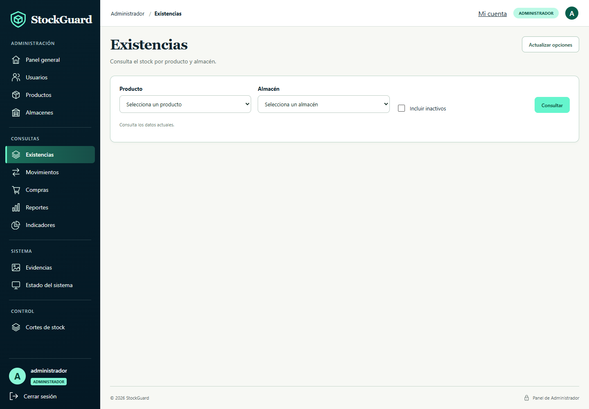

# Almacenes activos y consulta de inactivos

Correccion del 16/11/2026, posterior a la revision integrada local. El usuario autorizo
desactivar el almacen QA que seguia activo y mostrar activos por defecto en los selectores.

## Cambio de datos autorizado

En byteelement se ejecuto la API de Administrador PATCH /api/v1/almacenes/6/desactivar,
verificando antes su codigo QA-C3BD17E35F60 y nombre Almacen RF01. Ya estaban inactivos
los otros dos almacenes QA. Ahora los activos son A01, A02 y A03. Los seis registros se
conservan: no se borraron almacenes ni historial y no se actualizaron los otros almacenes.

Esta accion modifica expresamente el estado de ese registro en la base del usuario. Los
reportes anteriores de base original sin cambios corresponden a la revision previa de solo
lectura. No se agrega una migracion que desactive codigos QA en otras instalaciones.

## Comportamiento de interfaz

- Existencias, movimientos, compras, reportes e indicadores: el selector muestra activos
  por defecto. Incluir inactivos permite escoger tambien los desactivados, con su estado visible.
- Si se selecciona un inactivo y luego se desmarca la opcion, se limpia ese filtro y su
  resultado anterior para que no quede una consulta oculta seleccionada.
- Almacen: movimientos, transferencias y conteos nuevos mantienen solo activos en los
  formularios. La opcion historica no los habilita como origen/destino de operaciones.
- Compras: la solicitud nueva ofrece solo productos y almacenes activos, aunque se esten
  incluyendo inactivos en las consultas historicas.
- Supervisor: configurar politicas requiere productos/almacenes activos. La consulta de
  conteos permite incluir almacenes inactivos; al ocultarlos se limpia la seleccion afectada.
- Administracion de almacenes conserva todos los registros para gestionar su estado.

El filtro se basa en activo, no en el prefijo QA ni en una lista fija A01/A02/A03. Un nuevo
almacen activo creado por Administrador aparece normalmente. GET /almacenes conserva su
contrato y devuelve todos: el frontend distingue consulta historica de operacion.
La opcion cambia los almacenes disponibles en la lista; no redefine formulas o poblaciones
historicas. Todos los almacenes sigue siendo una consulta global, incluida la historia.

No se eliminaron productos QA ni registros con stock o movimientos. La procedencia de los
almacenes revisados coincide con backend/docs/APF1/Verificar-RF01.ps1, una verificacion antigua;
no se generan durante el arranque normal. Las pruebas futuras deben usar bases aisladas.

## Verificacion de esta correccion

| Comprobacion | Resultado | Evidencia |
|---|---|---|
| Angular, Node 26.13.1 | 102 pruebas en 13 archivos, todas aprobadas | [angular-tests.log](evidencias-selectores/angular-tests.log) |
| Compilacion de produccion | Correcta | [angular-build.log](evidencias-selectores/angular-build.log) |
| Chromium con Angular y API reales | 7 comprobaciones aprobadas, sin errores JavaScript | [navegador.json](evidencias-selectores/navegador.json) |
| Desactivacion del almacen QA | Un cambio de estado, ningun borrado | [desactivacion.json](evidencias-selectores/desactivacion.json) |

Las comprobaciones reales recorren Existencias, la solicitud de Compras, politicas, conteos,
historial de movimientos y destino de transferencia. Se verifico que el selector pasa de tres
opciones activas a seis con inactivos, que las tres desactivadas llevan etiqueta y que desmarcar
la opcion limpia una seleccion inactiva. Las visitas de navegador no registraron operaciones.

Se agregaron cinco pruebas de interfaz sobre opciones y cambios de formulario. No se
repitio la suite Java ni los veinte grupos completos de compra/inventario en esta correccion:
el backend no cambio. Su evidencia anterior conserva su fecha, huella y alcance propios.

